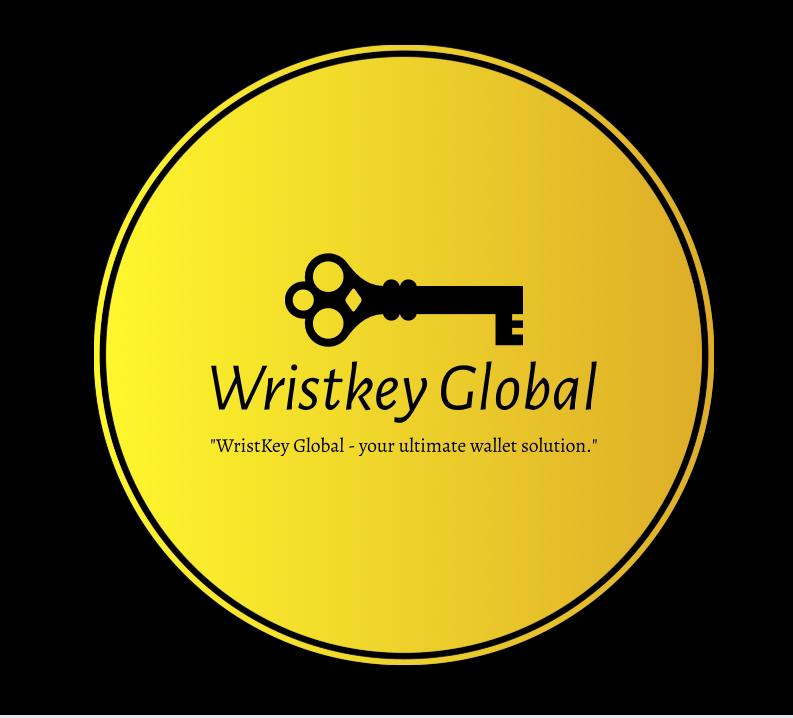
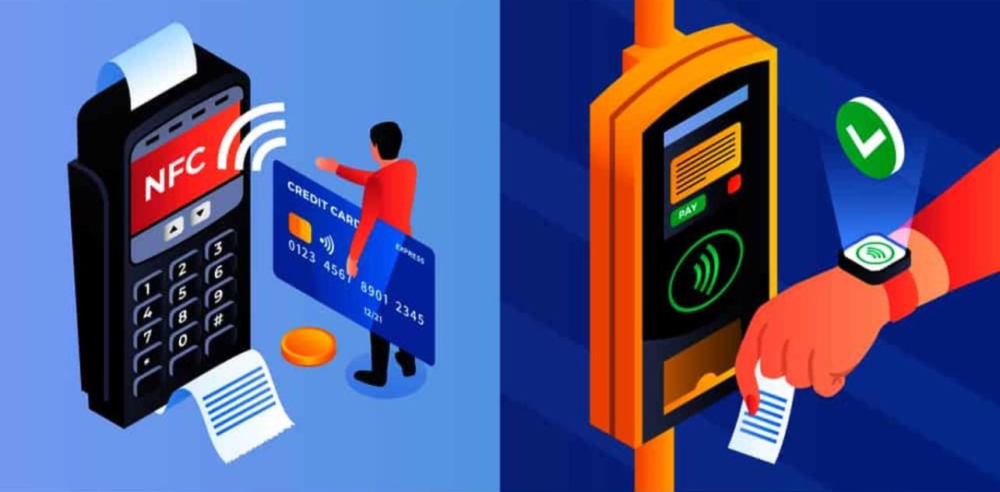
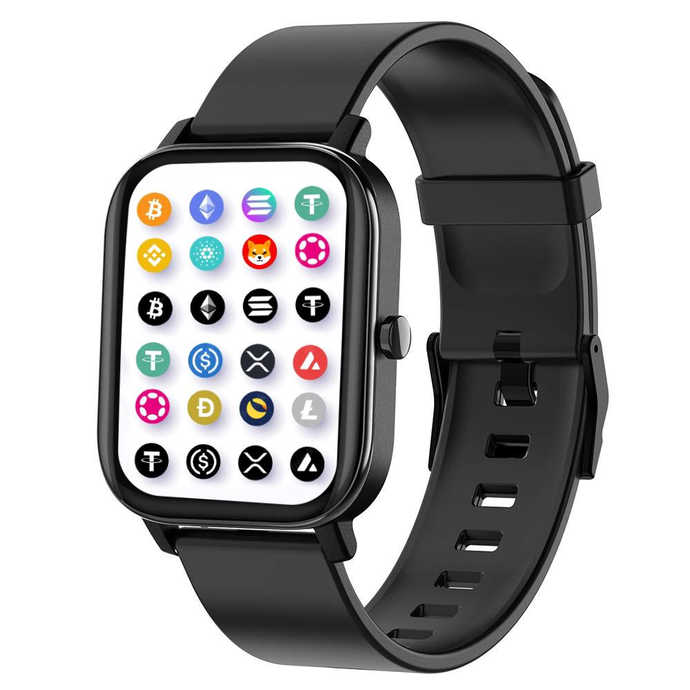
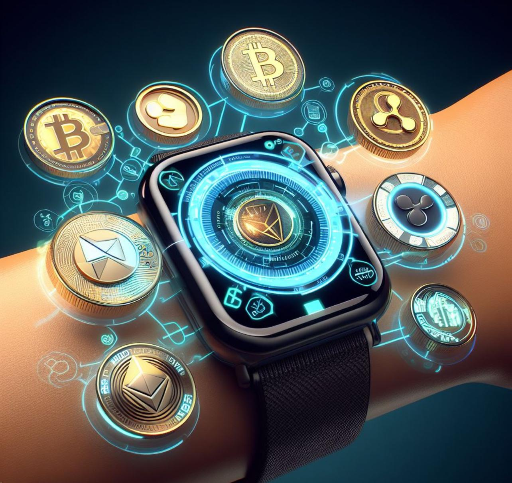
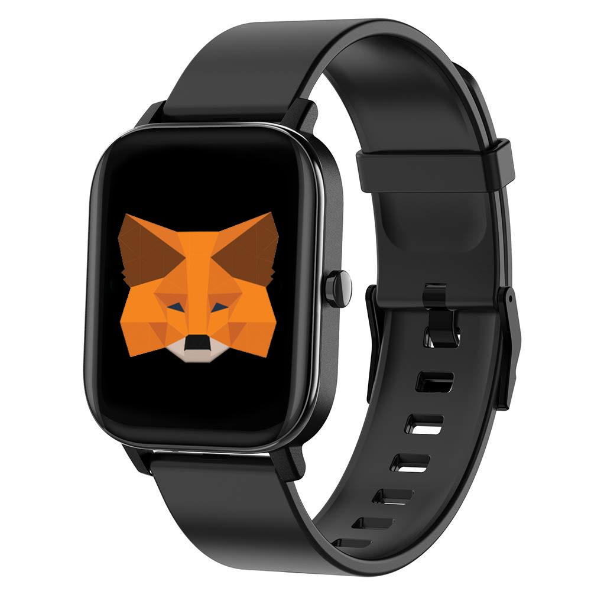
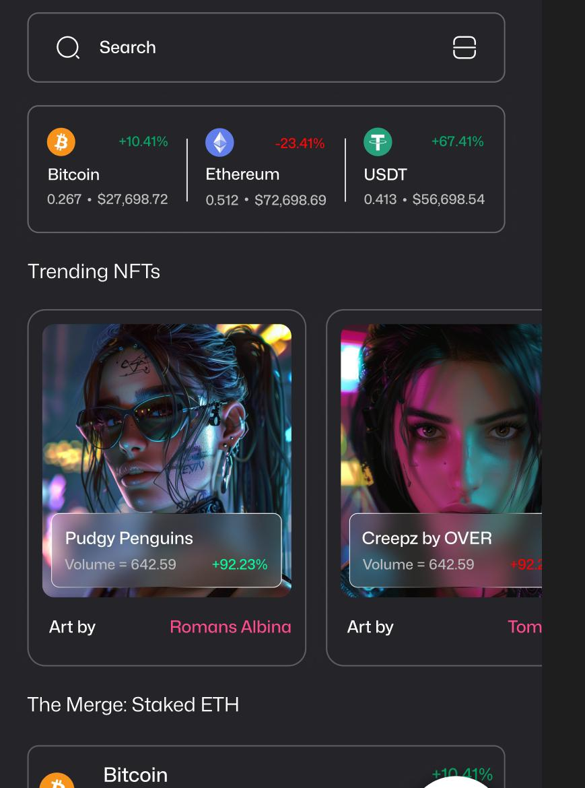
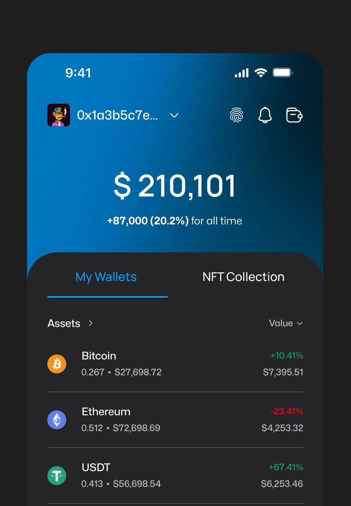

  

# Wristkey Global Solutions

## Introduction
**Overview of the current state of cryptocurrency wallet solutions:** Existing cryptocurrency wallet solutions often face challenges such as security vulnerabilities, complex user interfaces, and limited integration with hardware accessories. These issues hinder widespread adoption and user confidence.

**Introduction to Wristkey Global Solutions:** Wristkey Global Solutions aims to address these challenges with an innovative wallet protocol ecosystem that combines advanced security features, user-friendly interfaces, and unique hardware accessories.

**Vision and mission statement:** Our mission is to revolutionize digital asset management by providing cutting-edge technology and empowering users to take control of their financial futures.

## Executive Summary

### Project Overview
**Description of the wallet protocol ecosystem:** Wristkey Global Solutions offers a comprehensive wallet ecosystem featuring both cold and soft wallets, along with innovative hardware accessories such as NFC rings, smartwatch wallets, and credit card wallets.

**Key features and innovations:** The ecosystem includes biometric authentication, 2FA, smart contract integration, and unique hardware accessories designed to enhance security and user experience.

  
  
  

### Objectives
- **💪 Empowerment of individuals:** Our goal is to make cryptocurrency accessible to everyone, enhancing financial inclusion.
- **🔒 Enhancing security and accessibility:** We focus on providing top-notch security and a user-friendly experience.
- **🔗 Seamless integration within the Polygon network:** We chose Polygon for its scalability, efficiency, and low transaction costs.

## Market Analysis

### Current Market Landscape
**Analysis of existing wallet solutions:** Current wallet solutions often lack comprehensive security features and user-friendly interfaces, creating a gap in the market for more advanced solutions.

**Market demand for secure and user-friendly wallet systems:** There is a growing demand for wallet systems that offer enhanced security, ease of use, and innovative features.

### Target Audience
- **🔐 Crypto enthusiasts:** Individuals deeply invested in cryptocurrency.
- **👥 Everyday users:** People looking for a secure and convenient way to manage digital assets.
- **🏦 Financial institutions:** Banks and financial organizations interested in integrating cryptocurrency solutions.

  
  

## Product Description

### Wallet Protocol Ecosystem
**Detailed overview of the cold and soft wallet solutions:** Our ecosystem includes both cold wallets for maximum security and soft wallets for convenience and flexibility.

**Hardware accessories:** We offer NFC rings, smartwatch wallets, and credit card wallets, each designed for secure and convenient access to digital assets.

## Roadmap

### Phase 1
Conduct market research, form a skilled team, prepare a comprehensive whitepaper, and engage with the community for feedback.

### Phase 2
Launch the HHCWToken presale, develop the smart contract and prototype, and establish strategic partnerships.

### Phase 3
Officially launch HHCW1.0, list HHCWToken on major exchanges, launch a marketing campaign, and ensure user-friendly onboarding.

### Phase 4
Continuously enhance functionalities, expand distribution to international markets, engage the community, and introduce additional utility and decentralized governance for HHCWToken.

## Tokenomics
HHCWToken is the native utility token of the HHCW1.0 ecosystem, designed to power various functionalities, incentivize participation, and foster a thriving community. The tokenomics of HHCWToken are crafted to promote sustainability, utility, and long-term value for token holders and users.

### Token Distribution
The total supply of HHCWToken is set at 1,000,000,000 tokens, with 18 decimal places. The initial token distribution is as follows:
- **Presale Allocation:** 50% (500,000,000 HHCWToken) The presale allocation is reserved for early contributors and supporters of the project. Participants in the presale will receive HHCWToken at the mint price of 1, incentivizing early adoption and community engagement.
- **Team and Advisors:** 15% (150,000,000 HHCWToken) A portion of the tokens is allocated to the core development team and advisors as a reward for their expertise and efforts in building the HHCW1.0 ecosystem. This allocation ensures alignment between the team's interests and the success of the platform.
- **Platform Development:** 20% (200,000,000 HHCWToken) These tokens are allocated to fund the ongoing development, enhancement, and maintenance of the HHCW1.0 platform. The allocation ensures continuous innovation and scalability to meet the needs of the growing community.
- **Marketing and Community:** 10% (100,000,000 HHCWToken) This allocation is dedicated to marketing initiatives, community-building efforts, and partnerships. It aims to drive awareness, user acquisition, and engagement within the HHCW community.
- **Reserve Fund:** 5% (50,000,000 HHCWToken) The reserve fund is set aside to ensure liquidity, support market stability, and address any unforeseen circumstances that may arise during the project's lifecycle.

## Additional Links

  
   
  
   
  
   
  
   
  

<Button>
  <a href="https://hj5cy4us7b5.typeform.com/to/h7yV9HiC" style="display: inline-block; padding: 20px 40px; font-size: 20px; color: #fff; background-color: #4CAF50; text-align: center; text-decoration: none; border-radius: 10px;">
    Give Feedback
  </a>
  </Button>

### License

Wristkey is distributed under the terms of the MIT. See the [license](LICENSE) for more information.
